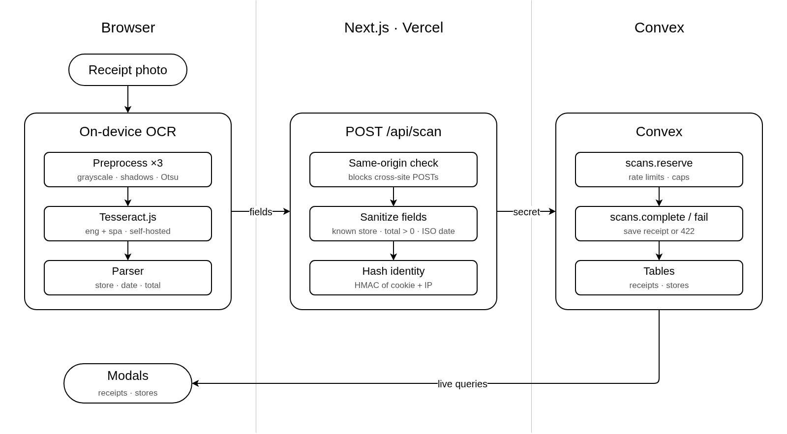

[](https://nextjs.org)
[](https://convex.dev)
[](https://github.com/naptha/tesseract.js)
[](LICENSE)

<p align="center">
  <h1 align="center">Receipt Scanner</h1>
  <p align="center">Reads the store, date and total from a receipt photo.</p>
</p>

<p align="center">
  <a href="#how-it-works">How it works</a> •
  <a href="#project-structure">Structure</a> •
  <a href="#quick-start">Quick start</a> •
  <a href="#deployment">Deployment</a> •
  <a href="#limits">Limits</a> •
  <a href="#ocr-parser">OCR parser</a>
</p>

## About

A webapp that scans photos with the use of local OCR. English (USD) and Spanish (CLP) receipts are supported. Authentication isn't needed for it's use.

## How it works



Receipt photo goes through on-device OCR in the browser, the extracted fields are POSTed to /api/scan on Next.js, which calls Convex with the server secret, and the modals read receipts and stores back through live queries.

| Step | Where | What happens |
| ---- | ----- | ------------ |
| 1 | [`src/lib/ocr/scan.ts`](src/lib/ocr/scan.ts) | Runs up to 3 preprocessed passes within a 30 s budget and stops once the result is confident |
| 2 | [`src/app/api/scan/route.ts`](src/app/api/scan/route.ts) | Rejects any field that isn't a known store, a positive total, `USD`/`CLP` or a `YYYY-MM-DD` date |
| 3 | [`src/lib/server/identity.ts`](src/lib/server/identity.ts) | Sets the httpOnly `receipt_uid` cookie and derives `userKey` / `ipKey` |
| 4 | [`convex/scans.ts`](convex/scans.ts) | Serializable mutations enforce the limits and save the receipt |

Convex write functions require `CONVEX_SERVER_SECRET`, so only the Next.js server can call them. The public receipt list never returns user keys.

## Tech stack

| Layer | Technology |
| ----- | ---------- |
| Framework | Next.js 16, React 19 |
| UI | Tailwind CSS v4, shadcn/ui, next-themes, sonner |
| OCR | Tesseract.js 7, LSTM only, `--psm 4`, English + Spanish |
| Backend | Convex |
| Hosting | Vercel |

## Project structure

```
├── assets/
│   └── workflow.png         # How it works diagram
├── convex/
│   ├── schema.ts            # receipts, stores, scanEvents, stats tables
│   ├── scans.ts             # reserve / complete / fail / getQuota / pruneOldEvents
│   ├── receipts.ts          # public list + summary
│   ├── stores.ts            # supported stores: list / listPage, internal upsert
│   ├── limits.ts            # every tunable limit and page size
│   ├── lib.ts               # assertServer() secret guard
│   └── crons.ts             # hourly prune of old scan events
├── scripts/
│   └── copy-tesseract-assets.mjs   # node_modules → public/tesseract (pre-dev / pre-build)
├── src/
│   ├── app/
│   │   ├── page.tsx
│   │   └── api/
│   │       ├── scan/route.ts       # validate fields, apply limits, store receipt
│   │       └── quota/route.ts      # remaining scans for the UI
│   ├── components/
│   │   ├── receipt-scanner.tsx     # upload, preview, scan
│   │   ├── receipts-dialog.tsx     # paginated receipts modal
│   │   ├── stores-dialog.tsx       # paginated stores modal
│   │   ├── page-controls.tsx       # shared usePages hook
│   │   └── ui/                     # shadcn components
│   └── lib/
│       ├── ocr/
│       │   ├── scan.ts             # worker setup + multi-pass loop
│       │   ├── preprocess.ts       # shadow removal, Otsu, sharpen
│       │   ├── parser.ts           # field heuristics
│       │   └── parser.test.ts
│       ├── server/                 # env + identity
│       └── i18n/                   # English / Spanish UI strings
└── public/tesseract/               # generated, gitignored
```

## Quick start

**Requirements:** Node 22.18+ and a Convex account.

```bash
npm install
npx convex dev
npx convex env set CONVEX_SERVER_SECRET "$(openssl rand -hex 32)"
echo 'CONVEX_SERVER_SECRET=<same value>' >> .env.local
npm run dev
```

Stores start empty. Add one so the scanner can recognize it:

```bash
npx convex run stores:upsert '{"name":"Lider","aliases":["Lider Express"]}'
```

| Command | Purpose |
| ------- | ------- |
| `npm run dev` | Dev server (copies the Tesseract assets first) |
| `npm run build` | Production build (copies the Tesseract assets first) |
| `npm test` | Parser tests (`node:test`) |
| `npm run lint` | ESLint |
| `npx tsc --noEmit` | Type-check |

### Environment variables

| Variable | Required | Description |
| -------- | -------- | ----------- |
| `CONVEX_DEPLOYMENT` | yes | Written by `npx convex dev` |
| `NEXT_PUBLIC_CONVEX_URL` | yes | Written by `npx convex dev` |
| `CONVEX_SERVER_SECRET` | yes | Long random string, set **both** in `.env.local` and on Convex |
| `NEXT_PUBLIC_DATE_ORDER` | no | `AUTO` (default), `DMY` or `MDY`. Inlined at build time |
| `SKELETON_DELAY_MS` | no | Dev only. Delays the page shell so the loading skeleton stays visible |

See [`.env.example`](.env.example).

## Deployment

**1. Convex.** Set the secret on the production deployment:

```bash
npx convex env set CONVEX_SERVER_SECRET <value> --prod
```

**2. Vercel.** Import the repo and keep the Root Directory at the repo root.

| Setting | Value |
| ------- | ----- |
| Build command | `npx convex deploy --cmd 'npm run build'` |
| `CONVEX_DEPLOY_KEY` | Production deploy key from the Convex dashboard |
| `CONVEX_SERVER_SECRET` | Same value as on Convex prod |
| `NEXT_PUBLIC_DATE_ORDER` | Optional |

The build command deploys the Convex functions and then builds Next.js.

## Limits

Defined in [`convex/limits.ts`](convex/limits.ts).

| Constant | Default | Scope |
| -------- | ------- | ----- |
| `USER_SCANS_PER_WINDOW` | 5 / hour | Per browser (cookie id) |
| `IP_SCANS_PER_WINDOW` | 15 / hour | Per IP, so clearing cookies doesn't reset the limit |
| `MAX_CONCURRENT_SCANS_PER_USER` | 1 | Scans in flight per user |
| `MAX_RECEIPTS_PER_USER` | 25 | Stored receipts per user |
| `MAX_TOTAL_RECEIPTS` | 1000 | Whole database |
| `LIST_PAGE_SIZE` | 10 | Rows per modal page |

Failed scans count toward the rate limit.

## OCR parser

[`parser.ts`](src/lib/ocr/parser.ts) works line by line. Every pass is scored, the passes are combined, and a field it isn't confident about comes back `null`.

| Field | Rule |
| ----- | ---- |
| **Total** | Amount on a "total" line. *Total Boleta* / *Total a pagar* outrank a plain *TOTAL*. Sub-Total, IVA, Dcto, item-count and related lines are ignored. A matching card payment line or a 19% IVA line adds confidence |
| **Date** | Fecha / Emisión / Date lines are preferred. Resolución and vencimiento dates are ignored. Ambiguous dates follow `NEXT_PUBLIC_DATE_ORDER` (`AUTO` = day-first on Spanish receipts) |
| **Store** | Fuzzy match against the Convex `stores` table only. Scans without a known store are rejected |
| **Currency** | Spanish text → `CLP`, English → `USD`. A printed `US$` / `USD` / `CLP` overrides it |
| **Amounts** | `1,234.56`, `1.234,56` and `$12.990` |

A scan with no store, date or total isn't saved, and the UI says which field is missing.

## License

[MIT](LICENSE) © 2026 DGVipe
